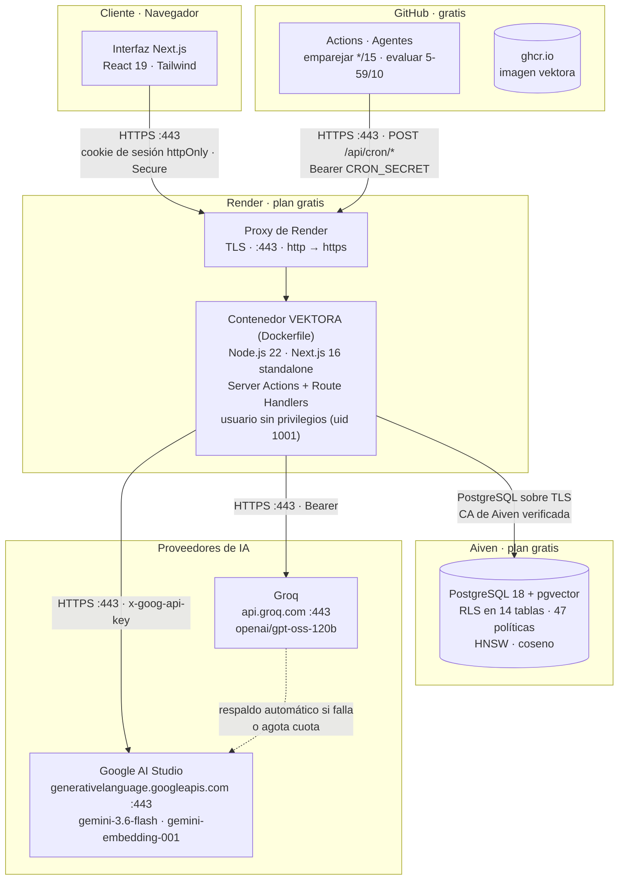
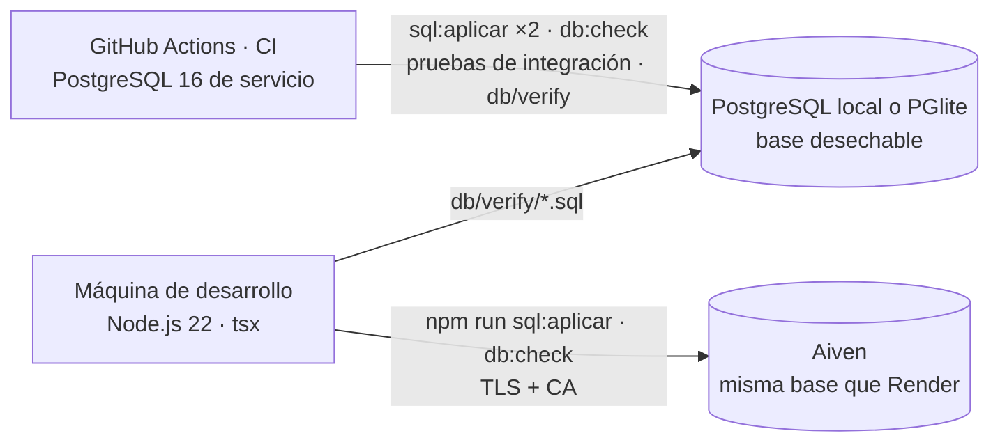

# Diagrama de infraestructura

VEKTORA corre en tres entornos con **la misma imagen Docker**; solo cambian las variables de
entorno. Todo en servicios gratuitos, sin tarjeta.

| Nivel | Dónde | Base | App |
|---|---|---|---|
| 1 · Local | PC | Contenedor `pgvector/pgvector:pg16` | Contenedor de la app, `docker compose up` |
| 2 · Nube | Internet | **Aiven** PostgreSQL 18, conexión **SSL** | **Render**, **HTTPS** en `https://vektora.onrender.com` |
| 3 · Taller | minikube | Deployment + PVC de 1 Gi | Deployment + Service NodePort |

## Componentes de producción (Nivel 2)

Los diagramas de compose y de minikube están en
[`diagramas/arquitectura.md`](diagramas/arquitectura.md), y el flujo de publicación en
[`diagramas/despliegue.md`](diagramas/despliegue.md).

## Protocolos y puertos

| Origen | Destino | Protocolo | Puerto | Autenticación |
|---|---|---|---|---|
| Navegador | Render | HTTPS (TLS de Render) | 443 | Cookie `vektora_sesion` (JWT HS256) |
| Render (proxy) | Contenedor | HTTP interno, `x-forwarded-proto: https` | el que fija Render | — |
| App | Aiven PostgreSQL | PostgreSQL sobre TLS | el del servicio Aiven | Usuario y contraseña de `DB_*`, CA en `DB_SSL_CA` |
| App | Groq | HTTPS/JSON | 443 | `Authorization: Bearer` |
| App | Google AI Studio | HTTPS/JSON | 443 | Cabecera `x-goog-api-key` |
| GitHub Actions | `/api/cron/emparejar`, `/api/cron/evaluar` | HTTPS | 443 | `Authorization: Bearer <CRON_SECRET>` |
| Render | `/health` | HTTP interno | — | Ninguna (no expone datos internos) |
| App (compose) | Base (compose) | TCP, red interna de compose | 5432 | `DB_*`, sin SSL (no sale de la PC) |
| App (minikube) | Service `vektora-db` | TCP, `ClusterIP` | 5432 | Secret `vektora-secret`, sin SSL (no sale del clúster) |

**La app habla directo con PostgreSQL** por el protocolo nativo, con el cliente `pg`. Eso
permite transacciones de varias sentencias (`transaction()`, R7) y consultas parametrizadas
(R9). En Aiven la conexión va **siempre por TLS y verificando el certificado** de la CA del
proyecto, así que nadie puede hacerse pasar por el servidor de la base.

## Separación de privilegios

Es la frontera que permite que el sistema sea autónomo sin ser inseguro.

| Quién | Cómo entra a la base | Alcance |
|---|---|---|
| Agentes (emparejar, evaluar), login, telemetría | `getDb().query(…)` como dueño de las tablas | Pleno: lo necesitan para operar sin que nadie inicie sesión |
| Una persona desde la interfaz | `getDb().asUser(id, …)`: `SET LOCAL ROLE authenticated` + `auth.uid() = id` | Sujeto a las 47 políticas RLS: ve y cambia solo lo suyo y lo público |
| GitHub Actions | Solo HTTPS a `/api/cron/*` con `CRON_SECRET` | No toca la base; si el secreto falta, la ruta responde 503 (cerrada) |

Las credenciales viven en el panel de Render, en el `.env` local y en el Secret de
Kubernetes, nunca en el repositorio. `gitleaks` lo comprueba en cada push sobre todo el
historial ([`informe-seguridad.md`](informe-seguridad.md)).

## Por qué el reloj es parte de la infraestructura

Sin un disparador periódico, el sistema solo avanzaría cuando alguien ejecutara una acción,
y eso sería intervención humana disfrazada. El workflow **Agentes** de GitHub Actions es lo
que convierte el ciclo en verdaderamente autónomo: empareja las tareas que quedaron
disponibles y evalúa los entregables en cola, sin que nadie lo pida. Render, en su plan
gratis, no trae tareas programadas; GitHub Actions sí, y gratis.

| Trabajo | Frecuencia | Qué hace |
|---|---|---|
| Emparejamiento | Cada 15 minutos | Adjudica las tareas disponibles al mejor candidato que supere el umbral |
| Evaluación | Cada 10 minutos (minuto 5, 15, 25…) | Juzga los entregables en cola, del más antiguo al más reciente |

Ambos son idempotentes y toman el turno de forma exclusiva, así que dos ejecuciones
solapadas no duplican trabajo ni reputación. Si Render está dormido (plan gratis), el
workflow reintenta hasta despertarlo.

## Entorno de desarrollo y verificación

Las funciones SQL se verifican por comportamiento sobre una base que se crea y se destruye
en cada corrida, **antes** de aplicarse en Aiven. Esa práctica nació de un incidente real:
dos guiones que parecían correctos a la vista fallaron al ejecutarse.

---

**Uso de IA y autoría.** Este documento se elaboró con asistencia de Claude (Anthropic,
modelo `claude-opus-5`). Las decisiones de diseño, la revisión y la verificación son de los
autores, que asumen la responsabilidad sobre su contenido. Constancia formal en
[`11-declaracion-de-uso-de-ia.md`](11-declaracion-de-uso-de-ia.md).
