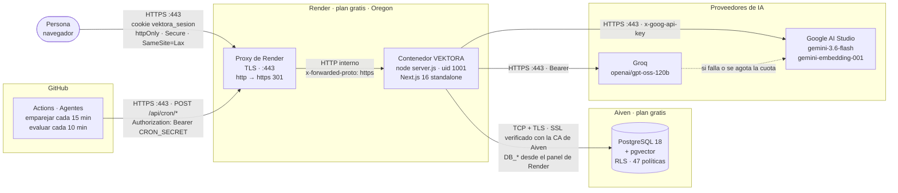
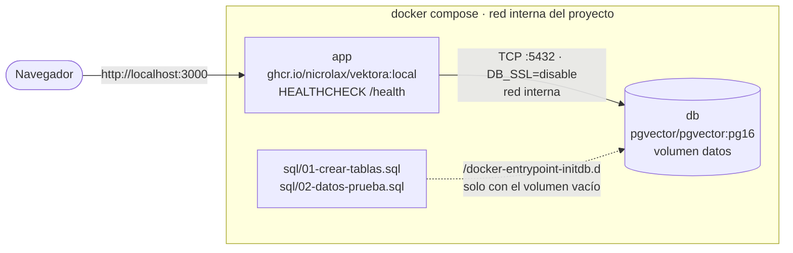
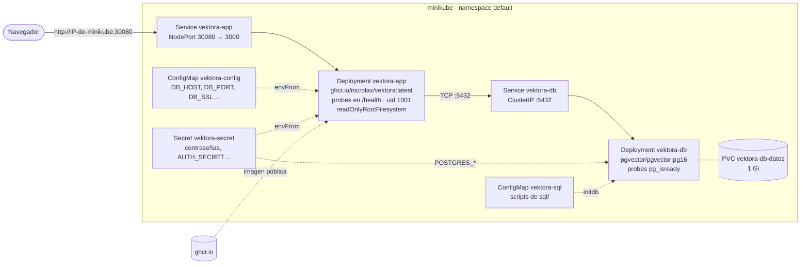

# Arquitectura de despliegue

Quién habla con quién, por qué protocolo y con qué credencial, en los tres entornos.

## Producción (Nivel 2): Render + Aiven

| Origen | Destino | Protocolo | Credencial | Dónde vive |
|---|---|---|---|---|
| Navegador | Render | HTTPS (TLS de Render) | Cookie de sesión (JWT HS256) | Navegador; la firma con `AUTH_SECRET` |
| App | Aiven | PostgreSQL sobre TLS, verificando la CA | `DB_USER` / `DB_PASSWORD` | Panel de Render (`sync: false`) |
| App | Groq / Google | HTTPS | `GROQ_API_KEY` / `GOOGLE_AI_API_KEY` | Panel de Render |
| GitHub Actions | `/api/cron/emparejar`, `/api/cron/evaluar` | HTTPS | `CRON_SECRET` | Secret del repositorio |
| Render | `/health` | HTTP interno | — | `healthCheckPath` en `render.yaml` |

**La base nunca se expone a internet sin TLS**, y la app no tiene credenciales escritas: todo
llega por variables de entorno (R10).

## Local (Nivel 1): docker compose

## Taller (Nivel 3): minikube

La base del clúster solo es alcanzable desde adentro (`ClusterIP`); hacia afuera se publica
únicamente la app.
