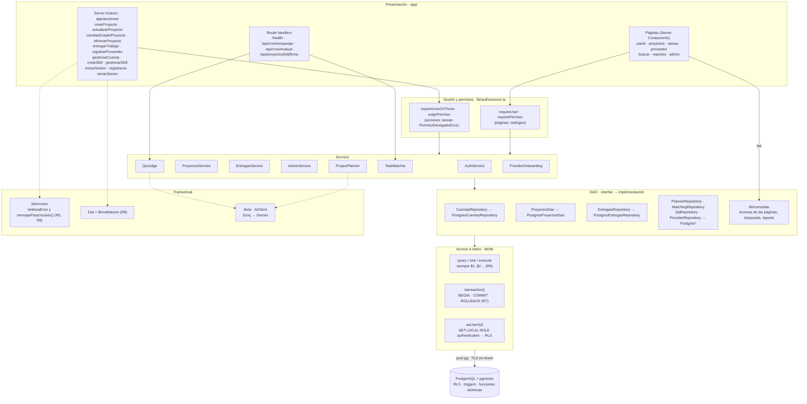
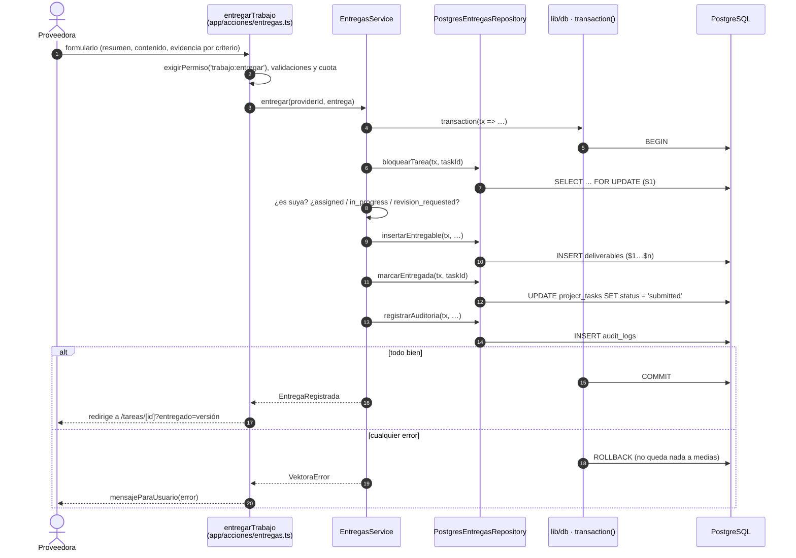
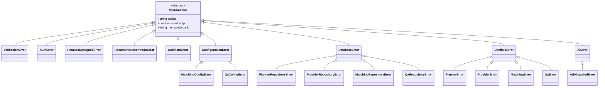

# Capas: presentación → servicio → DAO → base (R4)

Cada capa conoce solo a la de abajo, y siempre a través de una **interfaz**. Así la lógica
se prueba con dobles en memoria (sin red ni base) y la implementación real es `Postgres*`.

## Un pedido de punta a punta: «entregar trabajo»

Después, el workflow **Agentes** llama a `/api/cron/evaluar`: el `QaJudge` evalúa la entrega
criterio por criterio y aplica el veredicto con una sola función SQL atómica
(`apply_qa_verdict`).

## Jerarquía de errores (R5, R8)

`mensajeParaUsuario(error)` es el **único** camino de un error a la interfaz. Un
`VektoraError` muestra su mensaje pensado para la persona. Cualquier otra cosa (un error de
`pg`, un `TypeError`) se registra en el servidor y la persona ve un mensaje genérico, sin
detalles internos.
