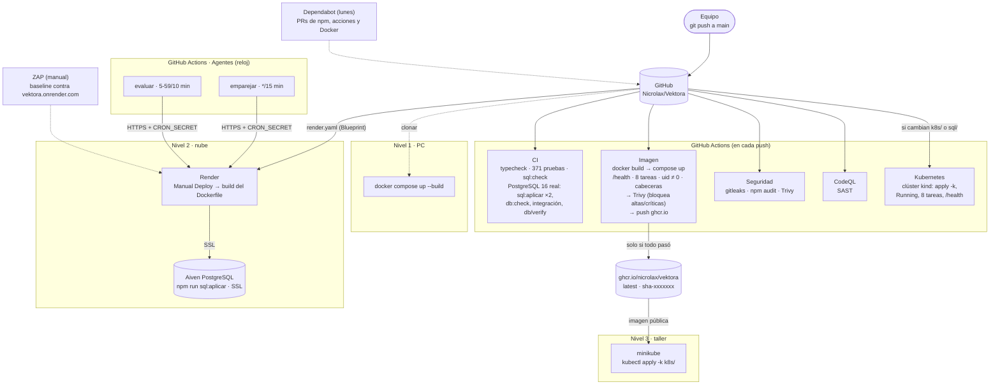

# Flujo de despliegue

De un `git push` a las tres puestas en marcha. Todo corre en servicios gratuitos y ninguna
contraseña viaja en el repositorio.

## Paso a paso

| Paso | Qué pasa | Dónde se configura |
|---|---|---|
| 1 | `git push` a `main` | — |
| 2 | **CI** compila, corre las pruebas y carga `sql/` dos veces en un PostgreSQL real (prueba que los scripts son idempotentes) | `.github/workflows/ci.yml` |
| 3 | **Imagen** construye el `Dockerfile`, la levanta con compose y la prueba. Trivy la escanea, y solo si todo pasa la publica | `.github/workflows/imagen.yml` |
| 4 | **Render** construye el mismo `Dockerfile` con *Manual Deploy → Deploy latest commit*. Las variables (`DB_*`, `AUTH_SECRET`…) están en su panel | `render.yaml` + panel de Render |
| 5 | **Aiven** guarda los datos. Los scripts se cargan una vez con `npm run sql:aplicar` desde una PC con el `.env` apuntando a Aiven | `.env` local (ignorado) |
| 6 | **minikube** descarga `ghcr.io/nicrolax/vektora:latest` y levanta la app y la base | `k8s/` + `k8s/secret.yaml` (ignorado) |
| 7 | **Agentes**: GitHub Actions llama a `/api/cron/*` con el `CRON_SECRET`. Es lo que hace avanzar el sistema sin que nadie intervenga | `.github/workflows/agentes.yml` + `vars.APP_URL` y `secrets.CRON_SECRET` |

Render no tiene despliegue automático: se creó desde la URL pública del repositorio. Por
eso, después de un push, hay que apretar *Manual Deploy*.
