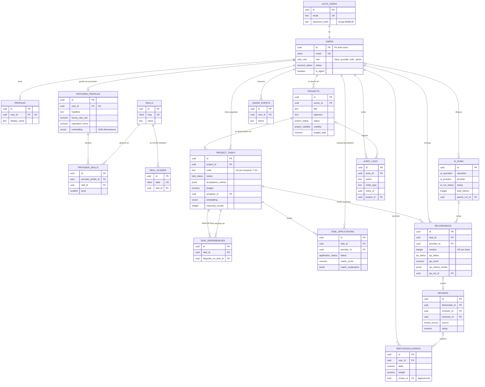

# Modelo de datos (entidad-relación)

Las 15 tablas de `sql/01-crear-tablas.sql`: 14 del modelo en `public` más `auth.users`. Se
muestran las claves y las columnas que importan para entender el sistema. La fuente de verdad
es la base: `npm run db:check` la compara con lo que espera el código.

## Relaciones que pide la consigna (R1)

| Tipo | Ejemplo | Cómo se implementa |
|---|---|---|
| 1:N | `users` → `projects` → `project_tasks` | `projects.owner_id`, `project_tasks.project_id` |
| N:M | proveedores ↔ skills | Tabla puente `provider_skills`, `unique (provider_profile_id, skill_id)` |
| N:M | tarea ↔ tarea (el **DAG**) | `task_dependencies`; un trigger impide cerrar un ciclo |
| N:M | proveedor ↔ tarea | `task_applications`, `unique (task_id, provider_id)` |
| 1:1 | `auth.users` ↔ `public.users` | Misma `id`; la contraseña vive solo en `auth.users` |

## Reglas que protege la base (aunque el código fallara)

- **Sin ciclos en el grafo:** trigger `prevent_dag_cycles` en `task_dependencies`.
- **Reputación append-only:** un trigger rechaza `UPDATE` y `DELETE` en `reputation_events`;
  las correcciones se agregan como un evento contrario.
- **Versiones de entregables:** `unique (task_id, version)`; la versión la pone un trigger.
- **RLS en las 14 tablas** con 47 políticas: cada persona ve lo suyo y lo público.
